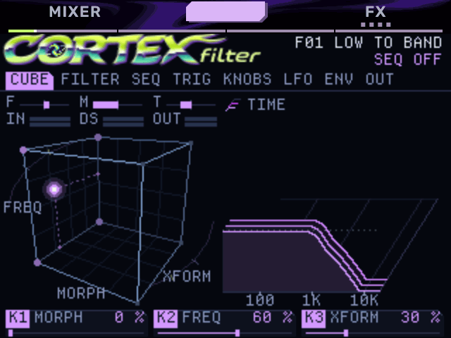
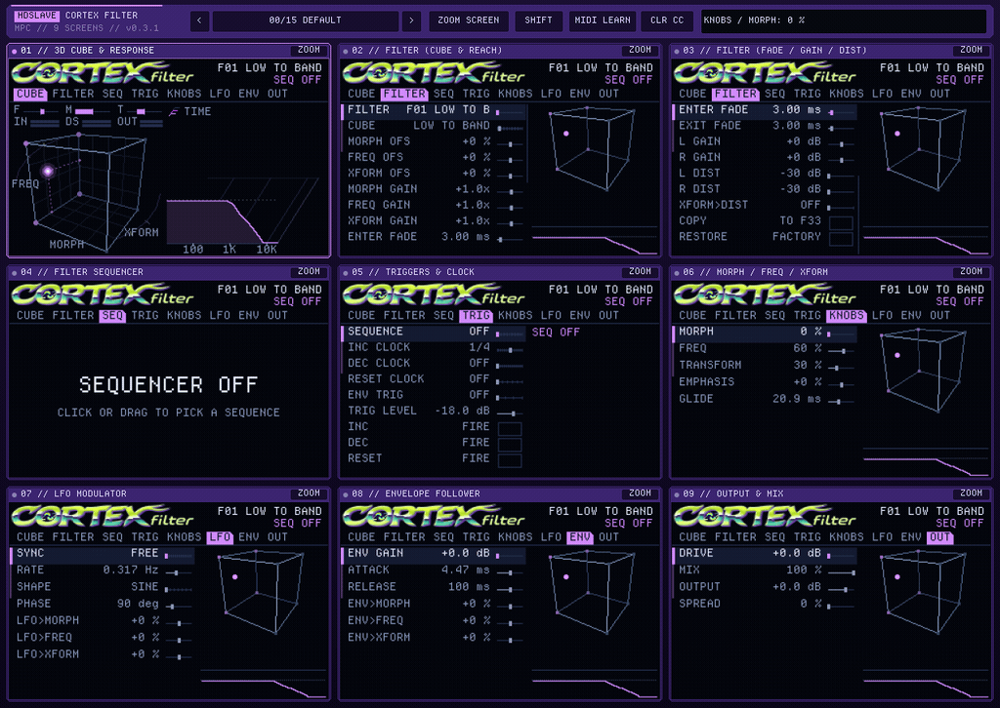

# hdslave Cortex Filter

**A stereo 3D Z-plane morphing filter cube and filter sequencer as a CLAP effect for the Akai MPC Sample.**

<table>
  <tr>
    <th width="34%">MPC Sample</th>
    <th width="66%">macOS and Windows · CLAP</th>
  </tr>
  <tr>
    <td align="center"><a href="docs/cortex-filter-screen.gif"></a></td>
    <td align="center"><a href="mac-clap/assets/desktop-preview.gif"></a></td>
  </tr>
</table>

> **Desktop CLAP version (macOS & Windows):** A separate desktop CLAP build with all MPC screens on one interactive panel lives in [**`mac-clap/`**](mac-clap/) (`cd mac-clap && ./install-macos.sh`). Releases in this repo stay MPC Sample-only for now while the desktop builds are being finalized.

Built for the Akai MPC Sample running [Melodee](https://github.com/keremimo/melodee-sample) / [hdslaveOS](https://github.com/hdslave/hdslaveOS) (64-bit ARM Linux, Cortex-A55). Hosts list it as **hdslave Cortex Filter** (id `com.hdslave.cortex-filter`). Inspired by classic "filter cube" morphing filters (E-mu's Z-plane filters and Rossum Electro-Music's Morpheus module), eight complex filters sit at the corners of a 3D cube while **Morph (X)**, **Freq (Y)**, and **Transform (Z)** smoothly navigate anywhere inside it. All cubes, filters, and factory sequences are original designs.

Since 0.2.0 it brings the full module workflow to the MPC: each **filter** in the 64-filter bank stores its own cube, axis offsets and ranges, fade-in/out times, per-side levels, and distortion (with Transform routable to distortion). A built-in **filter sequencer** steps through filter lists and commands (Pause, Halt, Bumper, Fade Time Scale) triggered by host clock divisions, the envelope follower, gate parameters, or the screen.

In **Melodee 0.7 and hdslaveOS 0.7**, Cortex Filter renders a live rotating 3D cube, a 3D frequency-response waterfall, axis/level meters, and dedicated filter-editing and sequence-programming pages (see [The screen](#the-screen)).

**Version 0.3.0** upgrades the audio DSP and cube voicing for smoother, fuller, more playable sound at under 3.5 % of one
A55 core in the worst distorted case: per-sample linear interpolation of the SVF and mix coefficients across the 8-frame
control steps (matching per-sample filter design to within 0.3 dB on modulation artifacts), re-staged in-filter
distortion with a linear-core soft knee that stays clean under 0 dB and never collapses in level up to +70 dB (plus
state rescaling across −30 dB and post-distortion smoothing through trailing low-pass bands), seamless same-cube filter
morphing in sequences (no mute dropouts on Acid Steps) with smoothstep fades on cube changes, a quadratic smoothed
envelope follower curve, high-Emphasis peak compensation on resonant LP/HP cubes, and re-voiced cubes (de-stacked
tenors in Vowels, low-passed modal Resonators with musical Qs, non-crossing Shepard Swirl, active mid-cube Harmonic
Comb, non-colliding Acid Twins, and stronger baseline levels).

**Version 0.3.1** completes the envelope-trigger fix at the top of Trig Level: at 96 kHz and over with slow
Env Attacks, 0 dB could still never fire, and it fires there now. It also refuses absurd song positions from a
host and keeps the filter design's rate constants per thread. The sound is otherwise 0.3.0's to the bit.

**Version 0.3.3** keeps the envelope follower right through silence. hdslaveOS lets a quiet effect sleep (it is not
run at all, so it counts no time): the follower stopped where it was, so Env Trigger stopped re-arming and the next
sound started the point from the stale envelope. Now, while the follower is still falling and something reads it,
the plug-in asks hdslaveOS to keep running it (see [Cost](#cost)). The sequence lets it sleep: it takes the song's
place and tempo from the transport when it wakes. For a Stop or a Play in a rest it needs an hdslaveOS that runs a
sleeping effect for the block in which the transport starts, stops or jumps (being added to hdslaveOS; earlier
builds miss them, and the sequence then runs off the song's grid until the next Play heard). The sound is otherwise
0.3.2's to the bit.

**Version 0.3.4** counts what the song passed while the effect was not run. hdslaveOS from 0.8.3-hdslave.4 (not
released yet) counts in CLAP's `steady_time` every frame a plug-in is not run for: asleep, bypassed, its track frozen
or empty. It also tells the song's loop while Song plays inside its loop brace. On waking, the effect moves on by
those frames as if it had run every block. The sequence steps by the Inc, Dec and Reset clocks the song passed (in
order; a gap of more than 256 of them is cut short by whole laps of the sequence, which lands on the same step for
one clock alone, or for two on a sequence without Pauses, Halts or Bumpers). The LFO is where it would be (free, or
synced with the song stopped; to the bit while its count of steps adds up exactly in a double, which is hours).
Filter changes' fades and the glides are not moved on: they go on from where they were.
- **After a sleep**, hdslaveOS runs the effect for the block in which the transport starts, stops or jumps, so
  before that block only the tempo can have changed. It lands for the song playing on (patterns), the loop going
  round, a locate back and a Stop during a rest, and at a tempo changed in the rest too: the loop's ends and the place
  a Stop holds tell where the song had got to. Following MTC, the song's own pace before the rest is followed, so its
  speed trim does not read as a locate. Still off:
  - a tempo change and then a locate back in the same rest;
  - a rest in which the tempo changed more than once, with the song ending up behind where either tempo told would
    have taken it (nothing tells when the tempo changed, so the clocks are counted at the tempo the effect fell asleep
    at; a Stop after any number of tempo changes lands);
  - following MTC, a rest begun less than a second after the song started, jumped or changed tempo, or one in which
    the trim moves the song more than a 32nd note off its pace before the rest: running slow, the sequence ends up
    ahead by the clocks in between.
- **Bypassed, frozen or its track emptied**, it may have missed anything. It counts only what the waking transport
  bears out: the song played on (at the tempo it was left at or the one now), the loop went round at that block, or
  the song stopped at the place the host holds. Otherwise it counts nothing, and the song's place takes it on as in
  0.3.3.
- **Which of the two it was**, the effect tells by counting its quiet as hdslaveOS's idle gate does: sound in its input
  before a block or in its output after one, a value set, the page used, the transport changed, or its own call to be
  kept running restart the count, and only 10 seconds of it let the gate sleep it. A gap begun sooner was not a sleep;
  a bypass, freeze or emptied track begun after 10 seconds of that quiet is taken for one. The gate's count also
  restarts for two things the effect cannot see (a Stop and a Play taken inside one block, and the host's All Sound
  Off when a project opens or a track's engine or plug-in changes): a bypass begun within 10 seconds of one may be
  taken for a sleep too.

In 0.3.3 a loop going round, a locate back or a Stop during a rest left the sequence behind, and the LFO stood still
while the effect slept. On a host whose `steady_time` stands still while the effect is not run (every hdslaveOS
build before 0.8.3-hdslave.4), it behaves as 0.3.3. Also fixed in 0.3.4, always awake too:
- a song place that steps back a little (less than a 64th note: a swung tick, the speed trim, a plug-in two tracks
  share) no longer fires a clock twice;
- Env Trigger with Trig Level at its −48 dB floor no longer fires in silence (it fired every 16 frames).

The sound is otherwise 0.3.3's to the bit.

## Signal flow

```
in (stereo) ──► Drive (soft saturation) ──► the filter: its cube, up to 7 bands in series, at the point
                                              Morph (X) · Freq (Y) · Transform (Z)
                                              moved by:  the knobs (glided by Glide)
                                                         + the LFO (three axes, phase-spread)
                                                         + the envelope follower (the input's level)
                                              each axis then scaled by the filter's gain and moved by its offset
                                              (or Transform's sum driving the distortion instead)
                                              Spread: the left and right channels at two points on Morph
                                              each side's distortion inside the bands, then its level
            ──► Mix with the dry input ──► Output ──► a soft limit above full scale (never past 2.0) ──► out (stereo)

the filter heard: Filter's, or the sequence's ◄── Inc · Dec · Reset ◄── clocks on the song's grid, the envelope
                                                                     follower, the Inc / Dec / Reset gates, the page
```

Each corner filter is up to seven bands in series. Each band is a state-variable filter whose low-pass, band-pass and
high-pass outputs are mixed with its input, so one band can be a peak or dip (in dB), a low or high pass, a band pass,
a notch or an all pass, or anything between. Inside the cube the corners' bands are blended (frequency and Q on a log
scale, the mix linearly, a bell's gain in dB) and the filter is built from the blend, so every point is one stable
filter and the morph moves smoothly. The point and the filter are worked out every 8 frames and their coefficients
interpolated linearly per sample across each step; gains glide every sample.

## Controls

| Control | Range | What it does |
|---|---|---|
| Filter | F01 – F64 | The filter heard while no sequence runs (below), and the one the edit filter's controls show. Changing between two filters on the same cube whose settings differ glides smoothly over Enter Fade without muting or clearing the resonant state; changing cubes (or fading between identical settings like Bar Gate) uses a smoothstep dip down over Exit Fade, clears the filter, and comes up over Enter Fade (3 ms each as the factory has them) |
| Morph | 0 – 100 % | X: the cube's first morph |
| Freq | 0 – 100 % | Y: in most cubes it moves the whole shape up or down in frequency (a cutoff knob for it) |
| Transform | 0 – 100 % | Z: the cube's second morph |
| Emphasis | ±100 % | Every band's Q, from half to four times as sharp; widened peaks come down as they widen, and high-Q resonant low/high-pass peaks are level-trimmed above Q = 4 so the level stays controlled |
| Glide | 1 ms – 2 s | How fast Morph, Freq and Transform follow their knobs |
| Drive | 0 – +24 dB | Into a soft saturator before the filter, blended in over its first 6 dB and level-compensated by half its gain; 0 dB is the input untouched |
| Mix | 0 – 100 % | The filtered sound against the dry input; 0 % with Output at 0 dB gives an input within full scale back to the bit |
| Output | −24 – +12 dB | After the mix |
| Spread | 0 – 100 % | Puts the left and right channels at different points on Morph, up to half its length apart |
| LFO Sync | Free, 8 Bars … 1/32 (with triplets) | Free runs at LFO Rate; the rest follow the song's place while it plays (the same part of the song gives the same movement) and run on at the tempo while it is stopped |
| LFO Rate | 0.02 – 20 Hz | The free LFO's rate |
| LFO Shape | Sine, Triangle, Saw Up, Saw Down, Square, S&H, Drift | S&H and Drift draw new values each cycle, the same for the same place in the song |
| LFO Phase | 0 – 360° | How far ahead of Morph's the LFO's phase is on Freq, and twice that on Transform: 0° moves all three together (a line), 90° turns it into an orbit |
| LFO > Morph, > Freq, > Transform | ±100 % | Depth on each axis: 100 % swings it half the axis each way |
| Env Gain | 0 – +24 dB | The envelope follower's input gain; triggers read −48 dB to 0 dB linearly in dB, while axis modulation uses a quadratic curve smoothed over 5 ms for punchy dynamic sweep without bass FM ripple |
| Env Attack | 0.1 – 200 ms | |
| Env Release | 5 ms – 2 s | |
| Env > Morph, > Freq, > Transform | ±100 % | Depth on each axis: 100 % moves it the axis's whole length at full level |

The point never leaves the cube: knobs plus modulation stop at its walls. Spread, the LFO and envelope depths and Env
Gain glide over 20 ms, as Emphasis does, so turning them moves the point smoothly. A preset glides in the same way; a
saved state (a project opening) lands at once, so it starts sounding as it was saved.

## Filters

A filter is a cube and the settings the module keeps with it. The bank holds 64 (F01 – F64): F01 – F16 are the
sixteen cubes as they are, F17 – F32 the factory's ways of using them (below), F33 – F64 empty for your own. An empty
filter is heard as Null. The **Edit Filter** controls show and change the filter **Filter** picks; choosing another
filter shows its settings. The bank, and every change to it, is saved with the project. Mind that in a desktop host:
the Edit Filter controls are ordinary automatable parameters, so automating one permanently rewrites that filter in
the bank (as turning the module's own controls would), and the rewritten filter is what the project saves.

| Control | Range | What it does |
|---|---|---|
| Cube | Null, the 16 cubes | Null passes the sound untouched (its level still applies) |
| Morph / Freq / Transform Offset | ±100 % | Where the knobs' middle (and no modulation) puts the point: +100 % is the axis's end. With an offset the knobs alone no longer reach the whole axis |
| Morph / Freq / Transform Gain | −9.9x – +9.9x | How far the knobs and their modulation reach, around the middle: 2.0x crosses the axis in half the knob's travel, a negative gain turns it round |
| Enter Fade, Exit Fade | 1 ms – 4 s | How long the filter takes to come in, and to go, when the filter changes; a change takes the old filter's Exit plus the new one's Enter |
| Left Gain, Right Gain | −40 – +40 dB | The filter's level on each side, after it |
| Left Dist, Right Dist | −30 – +70 dB | Distortion inside the filter: the cube's gain is staged before the bands and each band (before any trailing low-pass) feeds a linear-core soft-knee saturator, so how it breaks up depends on the cube. −30 dB is none at all; under 0 dB it only sets the headroom (clean until the signal inside reaches it, with no level jump or state burst across −30 dB); over 0 dB it drives into the saturators with bounded post-makeup so heavy drive stays thick and audible all the way to +70 dB |
| Xform > Dist | Off, On | On: the Transform knob, its modulation and Transform Gain (read as Dist Gain) drive the distortion, 10 dB for every 10 % of Transform from its middle, on top of Left and Right Dist; Transform sits where its offset puts it |

On the page, **Copy** puts the filter into the next empty slot (which Filter then picks) and **Restore** (pushed twice)
puts back the factory's filter, or empties one of yours.

## The sequencer

| Control | Range | What it does |
|---|---|---|
| Sequence | Off, 16 sequences | The sequence that picks the filter. Loading one (or starting the song) starts it at its first step |
| Inc Clock, Dec Clock | Off, 8 Bars … 1/32 (with triplets) | An Inc (or Dec) each time the playing song crosses that grid: on the beat, the same steps for the same part of the song. After a gap (Melodee lets the effect sleep through a rest while the song plays on) or a jump forward it catches up, in order, so the sequence is where it would be had it played through; a jump back (a loop) fires it when the song lands on the grid. A Stop or a Play in a rest is heard if Melodee runs the sleeping effect for that block (see Version 0.3.3), and the clocks the song passed while it slept before a loop round, a locate back or a Stop are counted if Melodee tells the frames slept (see Version 0.3.4) |
| Reset Clock | Off, 1 – 16 bars | A Reset on that grid. Inc and Dec on the same beat come first, so a sequence reset on the bar starts the bar on its first step. It catches up after a gap as Inc and Dec do, and a loop that starts on its grid resets each time round |
| Env Trigger | Off, Inc, Dec, Reset | The envelope follower as a trigger: each time it rises through Trig Level, that input fires; it fires again once it has fallen 6 dB under it (at the −48 dB floor, once it has fallen under the floor: silence never fires it) |
| Trig Level | −48 – 0 dB | |
| Inc, Dec, Reset | Low, High | Gates: each rise from Low to High fires (automation or another host's lanes); Push on the page fires them too |

A sequence is up to 32 steps, each a filter or a command, worked through as the module's manual has it:

- **Inc** and **Dec** move a step on or back, round the end, loading the filter there.
- **Pause**: Inc and Dec do nothing until a Reset, which ends the Pause and moves nothing.
- **Halt**: Inc and Dec do nothing until a Reset, which goes back to the first step.
- **Bumper**: a wall. Inc and Dec never cross it; at the first step it is a Pause already ended.
- **Fade x1/32 … x8**: scales the fades of every change after it (until the sequence starts again).
- **Reset** goes back to the first step (or ends a Pause).

The wheel on the CUBE page steps through the running sequence's filters, past its commands without their taking
effect. The clocks run only while the song plays; a sequence runs only while Sequence picks one with steps in it.

Factory sequences (S01 – S08; S09 – S16 are empty for your own; **Restore** on the page puts a factory sequence back):

| # | Sequence | Steps |
|---|---|---|
| 1 | Lowpasses | the low and band pass filters, to pick from with the wheel |
| 2 | Vowels | the vowels and wahs |
| 3 | Resonators | the combs, bells, plates and chords |
| 4 | Tone Shapers | the phasers, swirls, tubes, tilts and the rest |
| 5 | Acid Steps | eight steps between Acid Twins and its deep and bright filters, for sixteenths |
| 6 | Vowel Talk | Fade x1/4, then the slow vowels with the others |
| 7 | Bar Gate | Gate Tube and Hollow Tube in turn, then a Halt until the next Reset |
| 8 | Up And Down | five filters between two Bumpers: Inc and Dec clocks together make it wander |

## Cubes

Morph is X, Freq is Y, Transform is Z. Cubes keep their numbers forever (a filter stores its cube's number); new ones
go at the end. A host that keeps values scaled to a parameter's range (Melodee's knob bindings and recorded motion)
would read a recorded edit filter Cube differently once the list grows, so adding cubes is a change to make knowingly.
Filter's range (F01 – F64) and Sequence's (Off and 16) are fixed for the same reason. A project saved by 0.1.0 opens
with its Cube as the factory's filter for that cube, sounding as it did.

| # | Cube | Morph | Freq | Transform |
|---|---|---|---|---|
| 1 | Low To Band | low pass to band pass | cutoff, 31 Hz – 16 kHz | gentle 2-pole to resonant 4-pole |
| 2 | High To Band | high pass to band pass | cutoff | gentle to resonant |
| 3 | Vowels A E O U | A to E (O to U at the back) | the voice an octave down to an octave up | A/E to O/U |
| 4 | Vowels I U E A | I to U (E to A) | as above | |
| 5 | Phase Drift | a phaser's notches close together to far apart | sweeps them | sharpens them |
| 6 | Harmonic Comb | peaks on every harmonic to the odd ones | the root, 27 – 880 Hz | peaks to dips |
| 7 | Wah Talk | a wah to a three-peak talking mouth | the pedal, 300 Hz – 2.2 kHz | sharper |
| 8 | Bell Tower | ringing harmonics to a church bell's partials | pitch | rings longer |
| 9 | Radio Tuner | full range to a telephone band | moves the band | adds a honk and steep edges |
| 10 | Acid Twins | squelchy resonant low pass to resonant band pass | cutoff | splits the peak in two, a fifth apart |
| 11 | Hollow Tube | uneven notches to harmonic ones | moves them | adds peaks between them |
| 12 | Swirl | five peaks turning like a barber's pole (Shepard sweep: all climb monotonically, fading in at the bottom and out at the top) | shifts them | peaks to dips |
| 13 | Metal Plate | a struck plate's modes to a bar's | pitch | rings longer |
| 14 | Tilt Air | a tone control: dark to bright | shifts it | scoops the mids |
| 15 | Sub Thump | a sub boom to a punchy mid-bass with the boxiness cut | shifts it | resonates |
| 16 | Chord Bank | resonators on a major chord to a minor one | the root, 55 – 440 Hz | rings longer |

The cubes' levels are set so moving through one keeps its loudness: the resonating cubes' corners lose about 4 dB
on pink noise, and no point of any cube peaks above +18 dB anywhere up to 0.45 of the rate (`tools/levels.sh` prints
each corner's level and peak; the engine tests hold these at 44.1 and 48 kHz). A band that Freq pushes past 0.45 of
the rate stays there, its peak fading flat over the next half octave, so peaks never pile up at the top. Emphasis at −100 % stays within about 3.5 dB of the cube's level at 0; at +100 % the
resonant low and high pass cubes get louder, as resonance does (up to about 7 dB on Acid Twins).

## Factory filters

F01 – F16 are the cubes 1 – 16 as they are. The rest, each within about 1.5 dB of its cube's loudness:

| # | Filter | What it is |
|---|---|---|
| 17 | Deep Acid | Acid Twins, Freq −30 %, +6 dB of distortion |
| 18 | Bright Acid | Acid Twins, Freq +30 % |
| 19 | Vowel Crush | Vowels A E O U with Transform on the distortion |
| 20 | Fuzz Wah | Wah Talk, +12 dB of distortion |
| 21 | Wide Sweep | Low To Band, Freq Gain 2.0x |
| 22 | Narrow Band | High To Band, Morph +60 % |
| 23 | Bell Crush | Bell Tower with Transform on the distortion |
| 24 | Phase Invert | Phase Drift, Morph turned round |
| 25 | Slow Chords | Chord Bank, 250 ms fades |
| 26 | Slow Vowels | Vowels I U E A, 250 ms fades |
| 27 | Gate Tube | Hollow Tube, in at once, out over 80 ms |
| 28 | Telephone | Radio Tuner held at the telephone end of Morph |
| 29 | Sub Crush | Sub Thump, +18 dB of distortion |
| 30 | High Metal | Metal Plate, Freq +40 % |
| 31 | Split Swirl | Swirl, clean on the left, +6 dB of distortion on the right |
| 32 | Bypass | Null |

## Presets

Fifteen factory presets, inside the plug-in: Melodee lists them on the plug-in's PRESETS page (any host with CLAP preset
discovery does). A preset sets every control but the edit filter's: it picks a filter and a sequence from the bank as
it is, and leaves the bank alone. Each one's Output is set so it plays about as loud as the dry input (1 to 2 dB under
it on a loudness meter's weighting, `tools/balance.sh`).

| Preset | What it is |
|---|---|
| Init | Low To Band, still |
| Talking Loop | Vowels A E O U, a one-bar LFO talking across Morph and Transform |
| Phase Drift | The phaser, slowly sweeping (free LFO on Freq) |
| Envelope Wah | Wah Talk opened by the input's level (Env > Freq) |
| Harmonic Swirl | Harmonic Comb, a half-bar triangle LFO on Morph, the two sides apart (Spread) |
| Bell Ringer | Bell Tower with a little Drive, part dry |
| Acid Envelope | Acid Twins, Emphasis up, Drive, the cutoff following the input |
| Radio Drift | Radio Tuner wandering (Drift LFO on Freq and Transform) |
| Wide Space | Swirl orbiting over four bars, the two sides apart |
| Chord Glow | Chord Bank turning between major and minor over four bars, part dry |
| Acid Sequence | Acid Steps on sixteenths, back to its first step each bar, the cutoff following the input |
| Vowel Walk | Vowel Talk on eighths, two bars long, a one-bar LFO on Morph |
| Hit Steps | The resonators, a step on each hit (the envelope as Inc), part dry |
| Bar Gate | Bar Gate on eighths, reset each bar |
| Wander | Up And Down with Inc on quarters and Dec on quarter triplets: a walk between its walls |

## The screen

**Version 0.3.2** uses the official `melodee.screen/1` interface. In Melodee or hdslaveOS 0.7, focus Cortex Filter
in a track, bus or master FX chain to see its compact view. The cube tracks the morph position, the graph shows
the filter’s response, and K1–K3 show their assigned values and pickup marks. Push opens the full page with its
eight groups. Shift + Push returns to the chain with the current group’s K1–K3 assignments.
Hosts without this screen interface can use the CLAP parameter list.

- **CUBE**, the main display. On the left, the cube in 3D, swaying slowly while sound runs through it: the filter's
  point glowing (the right channel's in magenta when Spread splits them), its trail, the path the LFO will take
  (dotted), lines dropped from the point to the back walls, and the eight corners lit by how much of each the filter
  takes. Above it, as the module shows them: F, M and T (D when Transform drives the distortion), the knobs and
  modulation summed on each axis before the filter scales them, and each side's input, distortion and output meters
  (green, yellow from −6 dBFS, red past full scale; the distortion's red once its saturators bend). On the right, the
  filter's response (20 Hz – 20 kHz, −36 to +18 dB) in 3D: in **TIME** view the last moments of it, newest in front,
  receding into the past; in **MORPH** view the whole Morph axis at the current Freq and Transform, with the response
  now lit where it sits. Every response drawn is worked out from the same numbers the sound uses, and the tests hold
  the sound to it within 0.05 dB. The wheel loads the next filter in use (with a sequence running, the sequence's next
  filter), Push changes the view, K1-K3 turn Morph, Freq and Transform.
- **FILTER** edits the filter Filter picks, with **Copy** and **Restore** at the end.
- **SEQ** programs the sequence Sequence picks: seven of its steps round the cursor, the one playing marked (P or H
  while it waits). The wheel moves along the steps; Push edits one (the wheel picks a filter, a command, Insert Step,
  which puts a Pause before it, or Delete Step; Minus / Plus jump eight; Push sets it); after the steps, **+ Add Step**
  adds the filter Filter picks, and **Restore** (pushed twice) puts the factory's sequence back. K1-K3 turn Sequence,
  Inc Clock and Reset Clock.
- **TRIG**: the sequencer's clocks and triggers, with the sequence's steps beside them as squares. Push on Inc, Dec or
  Reset fires it (and asks Melodee to run the sound, so a sleeping effect takes it); a press the sound has not taken
  within half a second is dropped, not fired later.
- **KNOBS, LFO, ENV, OUT**: the controls, the cube small beside them with the response under it.

The header names the filter heard and the sequence's place (its step, or −P− and −H−, and a Fade scale other than x1),
lit yellow for a moment by each trigger. While no sound runs (and the envelope follower has fallen silent) Melodee
lets the effect sleep:
the cube and meters settle, and the page shows where the knobs put the point. The CORTEX lettering ripples one pixel
to either side on a 3.84-second loop. The O holds a clockwise spiral planet with a glint traveling around its ring. Both
move while anything else on the page does or the song plays, and for 4 seconds after the page opens, an input, a knob
or the sound stopping; then the title rests and the page asks Melodee for no paints until something changes. Changes made
on the page show at once; a K1-K3 turn shows once Melodee passes it to the plug-in. MORPH view's landscape still
catches up with a change while the sound sleeps.

On a list the controls are those of hdslave's other pages: the wheel moves a row; Push edits it (the wheel then changes
it: a choice a step, a knob 1/128, 1/1024 with Shift; Push again leaves); Minus / Plus change group (while editing,
move the value a sixteenth); K1-K3 turn the cursor's row and the two under it, with Melodee's takeover. Hold Shift
for these.

## Cost

Instructions a 128-frame block takes, from `tools/bench.sh` (callgrind, the MPC's 1.8 GHz in-order core at about one
instruction a cycle):

| Case | Instructions | Share of one A55 core |
|---|---|---|
| Worst: a seven-band cube, both sides apart, a fast LFO on all three axes, the envelope, Drive | about 137,000 | 2.9 % |
| The same with the filter's distortion on both sides | about 167,000 | 3.5 % |
| The same distorted, Acid Steps stepping every sixteenth | about 93,000 | 1.9 % |
| Typical: a five-band cube moved by the LFO | about 57,000 | 1.2 % |
| Standing still | about 42,000 | 0.9 % |

The page's input and output meters are worked out only while Melodee paints the page.

Since 0.3.3 the effect does not sleep while the envelope follower is still falling with an Env depth or Env Trigger
set: it asks Melodee to keep running it, so the follower falls as it would while sounding. Until what it follows is
under −100 dB, a rest then costs what the table says (silence costs as much as sound) instead of nothing: about
1.2 seconds after a full-scale sound at the default Env Release, about 23 seconds at the longest (at most about
3.5 % of a core meanwhile, the worst case above). With the follower at rest or unread it sleeps as before, a
sequence running or not. hdslaveOS itself keeps the effect awake for the 10 seconds of its reported tail after a
sound, so on the MPC this only adds time at the longest Env Releases (a fall over 10 seconds: Env Release above about
0.87 s). The follower is not settled on waking instead, as the sequence and the LFO are: it falls a sample at a time
in floats, and no closed form gives its roundings, so only running it keeps the sound to the bit.

The left and right channels run side by side in one vector register, through a loop unrolled for the cube's band
count. While the point moves, the filter is worked out again every 8 frames, with polynomial `exp2` and `tan`
(accurate to about 1e-6) and the corners blended four at a time, and its SVF and gain coefficients are linearly
interpolated per sample across each 8-frame step; standing still, neither runs. That keeps modulation artifacts
within 0.3 dB of per-sample filter design (`-98.1 dB` on a 3 Hz vowel sweep and `-83.0 dB` on a 20 Hz resonant sweep,
`tools/artifacts.sh`).

A frame of the CUBE page takes about 576,000 instructions (about 0.32 ms) on Melodee's screen thread in TIME view,
about 662,000 in MORPH view while the point moves (its landscape follows a few slices a frame), at most about 30
frames a second while it moves. The FX-chain strip costs about 333,000 instructions per moving frame in the same bench.
While nothing else moves, only the title is drawn again: a frame every 60 ms, about
18,300 instructions each (about 0.02 % of a core), for the 4 seconds it stays awake; then none, and none while the page
is out of view.

## Build and test

Needs Docker with a Linux arm64 context (Melodee's `colima-melodee` and its `melodee-builder` image by default).

```sh
./build.sh          # build/CortexFilter.clap, then the tests, the sound's fingerprint, demo renders and screen pictures
./build.sh bench    # build/bench
./build.sh sanitize # the tests and fingerprint scenarios under AddressSanitizer and UBSan
tools/bench.sh      # instruction counts (Melodee's melodee-profiler image)
tools/levels.sh     # each cube's corner levels and loudest peak
tools/balance.sh    # how loud the presets, cubes, Emphasis and Drive are against the dry input
tools/artifacts.sh  # what the 8-frame control steps add to a tone under a moving filter (against a step every frame)
```

- `tests/engine.cpp` checks the engine from the inside: the cubes' data, the blend, every point of every cube stable at
  three rates and both ends of Emphasis, the levels, the response maths against textbook filters and against the
  filter's own measured impulse, the LFO (shapes, rate, in step with the song, stopped, jumps, phase spread), the
  envelope follower, Glide, Spread, the walls, Mix 0, mono, the limit, the times at 44.1, 48 and 96 kHz (LFO rate,
  Glide, envelope release, the gains' 20 ms, the synced LFO), texts at the units' edges reading back to themselves,
  the page without a host (and its MORPH
  landscape: whole after a new cube, caught up within four frames of a move), the presets; the sequencer's rules
  (Inc and Dec round the end, Pause, Halt, Bumper, a Bumper or Halt first, Fade, the wheel past commands, steps put in
  and taken out), its clocks on the song's grid (none at the start, Inc before Reset on the same beat, stopped and
  started again; after a gap while the song plays on, short or long, across Resets or not, where a run throughout
  lands; a loop one Reset long resetting each time round; a jump back firing only onto the grid; the frames a host
  says it did not run, in blocks of 128 and 100 frames, landing on the step and the trigger count of a run throughout
  with the song playing on, its tempo changed, a Stop, a locate back and the loop going round, and the LFO on its
  place, to the bit free and synced while playing; and the review's cases: a host place 0.3 % slow or fast of its
  tempo over rests of 10 and 40 beats, a locate back by 1.5 beats after a 200 s rest, two tempo changes then a Stop, and, not a sleep, a Stop in a
  60 s gap counted and seven loop turns not; a place jittered by 0.002 beat a block firing each boundary once), the
  envelope trigger at its floor silent in silence, the gates' rising
  edges, the envelope as a trigger, the fades' times and their scaling; the filters' settings (Null giving the input
  to the bit, each side's gain, offsets and gains moving the point, Transform > Dist sounding as the plain filter at
  its bottom, distortion on one side leaving the other to the bit, bounded on loud
  noise); the factory's bank; and the review's fixes,
  each against its failure: the right side correct after Spread goes to 0 and back across a cube change, an infinite
  and a NaN input sample leaving every output a number and the sound back within a second, Drive leaving 0 dB without
  a click on a loud tone, and a cube change while a resonator rings dipping to silence with no burst.
- `tests/host.cpp` loads the plug-in through the CLAP API: description and ports, every parameter's text there and
  back, state (and older, foreign and cut-off states; 0.1.0's Cube loading as its factory filter; the bank and the
  sequences saved and loaded back to the byte, a sequence programmed on the page; a state loaded into a running
  plug-in sounding to the bit as one loaded before activation), presets as preset discovery lists them (the edit
  filter's controls showing the filter each picks); the measured response
  against the screen's for every cube at several points, Emphasis settings and three rates (within 0.05 dB); the
  Butterworth low and high pass measured with no help from the plug-in's maths; a vowel's formant peaks; the same
  output to the bit in blocks of 1, 3, 8, 64, 128, 333, 1024 and 4096 frames, the sequencer running (clocks, the
  envelope, a gate, edit filter changes); Mix 0 giving the input back to the bit;
  a mono input, no input, the same buffers in and out; random settings changed every 64 frames on loud noise staying
  finite and under 2, then ringing down to nothing; a sequence after a rest asleep sounding as with the rest played
  through, and a loop one Reset long sounding the same each pass; Melodee's idle gate modelled block by block
  (asleep after its reported tail's 10 seconds under −100 dB, woken by input, by the plug-in's own request, and for
  one block by a transport start, stop or jump; `steady_time` counting the frames slept and bypassed, and the song's
  loop told): Vowel Walk sleeping through 14-second rests with a Stop and a Play from the top in one, a Play, a tempo
  change, a locate forward and a loop going round onto its Reset, and with Reset Clock Off the song playing on, a loop
  going round, a locate back, a Stop, and the loop going round or a Stop after a tempo change, each sounding a second
  after the rest as with every block run; bypassed while it sounds, the song playing on and a Stop landing too; off
  with the host as it was (no wake on the transport, `steady_time` still while asleep); 0.3.3's sound with
  `steady_time` still; and off, as the limits left, after a tempo change and then a locate back in one rest, and a
  locate back in a bypass; its count of quiet as the host's: a sleep after one input sample just over −100 dB still
  landing, and kept awake by the loop's turns or the falling follower then bypassed, no sleep taken (the same with
  that sample before the bypass or not, a plain Stop in it landing); a free LFO, and one synced with the song
  stopped, through a rest; Env Trigger stepping a sequence through rests
  and Env > Morph's follower sounding to the bit as with every block run, the effect sleeping again once the follower
  is under −100 dB, and a plain filter sleeping as before; the page's presses dropped when stale or after a
  stop, reset or deactivation; and the page (its title moving for 4 seconds and then resting with no paints asked
  for, woken by an input or the page opening, the graphs
  follow the sound and the knobs, drawing a new frame every 40 ms of playback, its controls set the values the host hears, the wheel
  loading filters, an edit kept in its filter, Copy and Restore, a step edited on SEQ, Inc pressed on TRIG asking
  for the sound to run, MORPH view catching up by itself while the sound sleeps). It writes the presets through a test loop to
  `build/demo-*.wav` (`demo-dry.wav` is the loop itself, `demo-every-cube.wav` sweeps each cube in turn) and the page
  to `build/screen-*.png`.
- `tests/fingerprint.cpp` renders 128 fixed scenarios (each preset, each cube at three points, random settings changed
  as it plays, other rates, other block sizes, the song stopping and jumping under a synced LFO; from 0.2.0 the
  factory's filters F17 – F32 at three points, a sequence under the stopping and jumping song, gates and the envelope
  moving a sequence, the edit filter changed as it plays) and hashes every
  output sample against `tests/fingerprint.txt`: work meant to keep the sound, such as a speed-up, must leave every
  hash as it is. The other block sizes must also hash as 128 frames do, whatever the file says. A change meant to change the sound updates them with `make fingerprint-update` (inside the build
  image).

It has also been opened by Melodee's own CLAP host (hdslaveOS's `clap_check`: an effect, 46 parameters, stereo
in and out, 15 presets, plays and restores its state) and its page drawn by Melodee's `--melodee-plugin-screen`
(the wheel loading filters, K1 picking a sequence, SEQ, FILTER and TRIG naming their K1-K3). It has not yet been run
on the MPC.

## Install

Copy `build/CortexFilter.clap` to `Melodee/Plugins/hdslave/hdslave Cortex Filter.clap` on the card, then
add it to a track's effects. It needs only libc and libm, glibc 2.35 or newer (the MPC has 2.39).

## Credits

- The screen's type: Departure Mono, copyright 2022–2024 Helena Zhang, SIL Open Font License 1.1
  (`licenses/OFL-departure-mono.txt`); its glyphs are rasterized into `src/ui/font.h`.
- The screen extension's header, `src/melodee_screen.h`, is from Melodee by Kerem Kiliç (Ellic Studio), MIT.
- CLAP headers: MIT license, `third_party/clap/LICENSE`.
- The vowel formants are the standard published tenor values (five formants' frequency, level and bandwidth).
