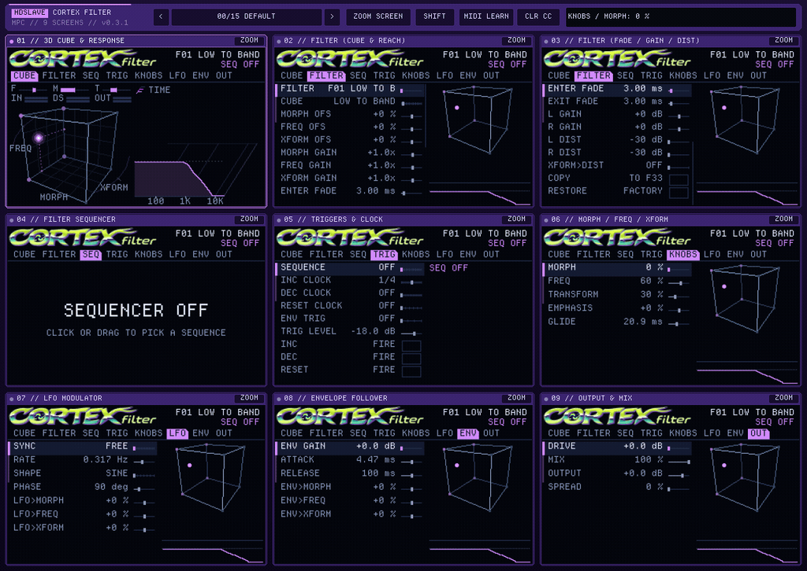

# hdslave Cortex Filter — macOS (and Windows) Desktop CLAP Plug-in

Separate desktop CLAP build of **hdslave Cortex Filter** for **FL Studio** (2024+) and any other CLAP host on macOS (Apple Silicon / Intel) and Windows (x64).



- **Multi-Screen MPC Dashboard:** displays all of hdslave Cortex Filter's native MPC screens simultaneously on one resizable Retina/HiDPI panel (with the hardware `K1`–`K3` footer panels removed) and direct mouse, trackpad, and touch control over every parameter, plot, sequencer, and pad.
- **The same plug-in as the MPC build:** `src/` here is the MPC plug-in's `../src` plus this panel's own edits, so the sound, the parameters (46), the presets (15) and the saved state (version 2) are the MPC build's. The version the bundle reports is read from `src/params.h`, the same line the MPC build uses.
- **Standalone from the MPC Sample build:** the build itself is this directory's own (`./build-macos.sh`, `./build-windows.ps1`); the MPC build stays `../build.sh`. GitHub releases remain MPC Sample-only for now while the desktop builds are being finalized.

## Keeping it in step with the MPC plug-in

`src/` is a copy, so it goes stale whenever the MPC plug-in changes. `desktop-fork.patch` holds the only differences — the page's `K1`–`K3` footer and legend removed, 9-row lists with pinned tops, the "click or drag" text, and the tiles extension the panel draws from. Re-sync and rebuild in one step:

```bash
cd mac-clap
./sync-from-mpc.sh
```

It copies `../src` over `src/`, applies the patch, and stops if a hunk no longer fits (a changed region needs the patch updated, not a half-copied tree), then builds and runs the host test. Currently synced to **0.3.2**.

## Build & Install (macOS)

Requires Xcode Command Line Tools and CMake 3.20+ (Ninja optional):

```bash
cd mac-clap
./build-macos.sh
./install-macos.sh
```

`install-macos.sh` builds, ad-hoc signs, tests, and installs `CortexFilter.clap` to `/Library/Audio/Plug-Ins/CLAP/` (pass `--user` to install to `~/Library/Audio/Plug-Ins/CLAP/`). Quit and reopen FL Studio after reinstalling so macOS reloads the updated bundle.

## Build (Windows x64)

```powershell
cd mac-clap
.\build-windows.ps1
```

Copy `build\windows\clap\Release\CortexFilter.clap` to `C:\Program Files\Common Files\CLAP\`.

Not yet run: no Windows machine has built this, so the Windows build and the Win32 panel are untested.
